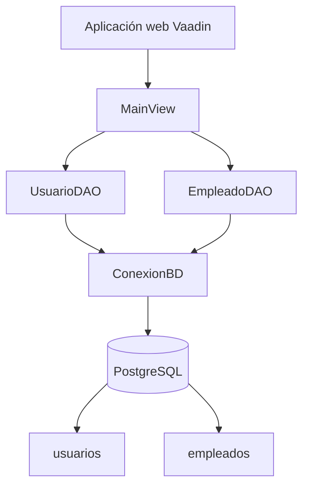
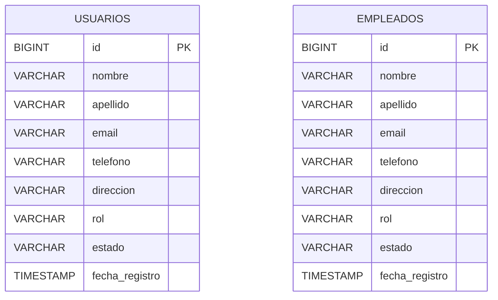

# Proyecto Integrador - Gestión de Entidad Financiera

----------------------------------------------------------------------

Este proyecto consiste en una aplicación web para administrar información de usuarios y empleados de una entidad financiera.

La aplicación permite registrar, consultar, modificar y eliminar registros desde una interfaz desarrollada con Vaadin. La información se almacena en una base de datos PostgreSQL.

Para la conexión con la base de datos utilizamos JDBC y consultas SQL escritas directamente en Java, sin utilizar Hibernate para las operaciones CRUD.

## Tecnologías utilizadas

- Java 25
- Spring Boot 4.1.1
- Vaadin 25.3.0
- PostgreSQL 17
- JDBC
- Maven
- Git y GitHub

## Funcionalidades

El proyecto está dividido en dos módulos.

### Usuarios

Desde esta sección se pueden realizar las siguientes operaciones:

- Registrar un usuario.
- Consultar los usuarios guardados.
- Seleccionar un usuario de la tabla.
- Modificar sus datos.
- Eliminar un usuario con confirmación.

### Empleados

Esta sección permite:

- Registrar empleados.
- Consultar los empleados existentes.
- Seleccionar y modificar su información.
- Eliminar registros con confirmación.

En ambos módulos se validan los campos obligatorios, el formato básico del correo electrónico y las longitudes permitidas.

## Organización del proyecto

El código está organizado en las siguientes clases:

text
src/main/java/com/example/
|
|-- Application.java
|-- MainView.java
|
|-- model/
|   |-- Usuario.java
|   |-- Empleado.java
|
|-- dao/
|   |-- ConexionBD.java
|   |-- UsuarioDAO.java
|   |-- EmpleadoDAO.java
|
|-- PruebaConexion.java
|-- PruebaUsuarioDAO.java
|-- PruebaEmpleadoDAO.java
```

`Application.java` permite iniciar la aplicación.

`MainView.java` contiene la interfaz con los formularios, botones y tablas de usuarios y empleados.

En la carpeta `model` están las clases que representan los datos del sistema.

En la carpeta `dao` se encuentran las operaciones de acceso a la base de datos.

También se incluyen clases utilizadas durante las pruebas de conexión y funcionamiento.

## Conexión con la base de datos

La base de datos utilizada se llama `proyecto_integrador` y se ejecuta en PostgreSQL.

La conexión se realiza desde `ConexionBD.java` utilizando JDBC.

Los DAO ejecutan instrucciones SQL mediante `PreparedStatement`. Esto permite enviar los valores de los formularios como parámetros, sin concatenarlos directamente con las consultas.

Las operaciones utilizadas son:

| Operación | Instrucción SQL |
|---|---|
| Crear | INSERT |
| Consultar | SELECT |
| Actualizar | UPDATE |
| Eliminar | DELETE |

Cada módulo utiliza su propia tabla. Los usuarios se almacenan en `usuarios` y los empleados en `empleados`.

## Diagrama de funcionamiento



La interfaz recibe los datos ingresados por el usuario y llama al DAO correspondiente.

El DAO ejecuta la consulta SQL utilizando la conexión JDBC y devuelve el resultado para mostrarlo en la aplicación.

## Modelo de datos

Las dos entidades manejan información básica de identificación y contacto.



Por ahora, las tablas son independientes y no tienen una relación mediante claves foráneas.

## Requisitos para ejecutar el proyecto

Se necesita tener instalado:

- Java JDK 25.
- PostgreSQL 17.
- Un editor de código, como Visual Studio Code.
- Git, para clonar el repositorio.

El proyecto incluye Maven Wrapper, por lo que no es necesario instalar Maven por separado.

## Configuración de PostgreSQL

Primero se debe crea una base de datos llamada `proyecto_integrador`.

La configuración de conexión utilizada durante el desarrollo fue:

```text
Host: localhost
Puerto: 5432
Base de datos: proyecto_integrador
Usuario: postgres
```

La contraseña se obtiene mediante la variable de entorno `DB_PASSWORD`, por lo que no se guarda directamente en el código.

### Creación de las tablas

Una vez creada la base de datos, se pueden ejecutar las siguientes instrucciones desde Query Tool de pgAdmin, conectado a `proyecto_integrador`.

```sql
CREATE SEQUENCE IF NOT EXISTS usuario_seq
START WITH 1 INCREMENT BY 1;

CREATE TABLE IF NOT EXISTS usuarios (
    id BIGINT PRIMARY KEY DEFAULT nextval('usuario_seq'),
    nombre VARCHAR(100) NOT NULL,
    apellido VARCHAR(100) NOT NULL,
    email VARCHAR(150) NOT NULL,
    telefono VARCHAR(30),
    direccion VARCHAR(200),
    rol VARCHAR(50),
    estado VARCHAR(30),
    fecha_registro TIMESTAMP
);

CREATE SEQUENCE IF NOT EXISTS empleado_seq
START WITH 1 INCREMENT BY 1;

CREATE TABLE IF NOT EXISTS empleados (
    id BIGINT PRIMARY KEY DEFAULT nextval('empleado_seq'),
    nombre VARCHAR(100) NOT NULL,
    apellido VARCHAR(100) NOT NULL,
    email VARCHAR(150) NOT NULL,
    telefono VARCHAR(30),
    direccion VARCHAR(200),
    rol VARCHAR(50),
    estado VARCHAR(30),
    fecha_registro TIMESTAMP
);
```

## Como se ejecuta el proyecto?

Primero se descarga o clona el repositorio de GitHub.

Desde la carpeta principal del proyecto, donde se encuentra `pom.xml`, se puede comprobar la compilación con:

```powershell
.\mvnw.cmd clean compile
```

Para configurar la contraseña de PostgreSQL en PowerShell:

```powershell
$env:DB_PASSWORD = [System.Net.NetworkCredential]::new("", (Read-Host "Contraseña de PostgreSQL" -AsSecureString)).Password
```

Después se inicia la aplicación con:

```powershell
.\mvnw.cmd spring-boot:run
```

Cuando Spring Boot termine de iniciar, se abre el navegador en:

http://localhost:8080

Allí aparecen las pestañas Usuarios y Empleados, desde las cuales se pueden realizar las operaciones CRUD.

Las pruebas incluyeron:

- Crear registros desde los formularios.
- Consultar información guardada.
- Modificar los datos de registros existentes.
- Eliminar registros seleccionados.
- Cancelar una eliminación desde la ventana de confirmación.
- Recargar la página y consultar nuevamente para comprobar que los cambios permanecen en la base de datos.

También se utilizó `clean compile` para comprobar la compilación del código después de realizar modificaciones.

Estas verificaciones se realizaron manualmente durante el desarrollo.

## Integrantes

Daniel Gil Rodriguez
